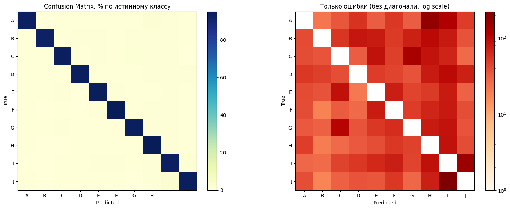
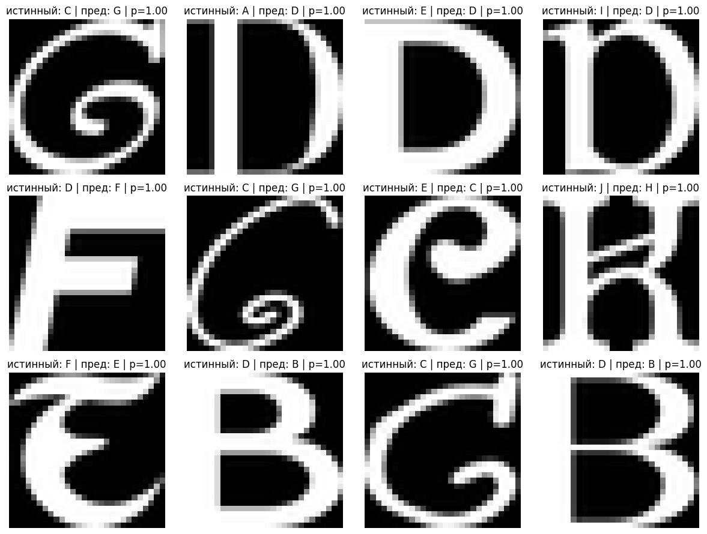

# Классификация букв notMNIST (CNN на PyTorch)

Классификация изображений букв от A до J, написанных разными шрифтами. Проект сделан в рамках программы профессиональной переподготовки НГУ «Машинное обучение и нейронные сети».

## Данные

notMNIST_large — 529 тысяч картинок 28×28, 10 классов. При загрузке проверял каждый файл, 5 битых картинок пропустил. Разбил данные на обучение, валидацию и тест в пропорции 70 / 15 / 15.

## Что сделал

- Написал свою свёрточную сеть: три блока Conv → BatchNorm → ReLU → MaxPool и два полносвязных слоя.
- Обучал 8 эпох: SGD с momentum 0.9, lr 0.01, batch 128, CrossEntropyLoss.
- Следил за loss, precision и recall на обучении и валидации, финальное качество посчитал на тесте.
- Разобрал ошибки: матрица ошибок, самые частые путаницы и примеры картинок, на которых модель ошибается увереннее всего.

## Результаты

На тесте: **precision 0.936, recall 0.936** (macro).

Самые частые путаницы: J → I (223), A → H (172), I → J (147), C → G (127). Буквы I и J в декоративных шрифтах и правда похожи.

Интересно, что среди ошибок с уверенностью 100 % многие картинки на самом деле подписаны неправильно: например, с меткой «C» нарисована G, а с меткой «D» — B. То есть часть ошибок — это шум в разметке датасета, а не ошибка модели.

## Как запустить

1. Открыть `notmnist_cnn.ipynb` в Google Colab (лучше с GPU).
2. Положить архив `notMNIST_large.zip` на Google Drive в `MyDrive/Datasets/` или рядом с ноутбуком.
3. Запустить ячейки по порядку.

## Стек

Python, PyTorch, torchvision, scikit-learn, matplotlib, Google Colab
